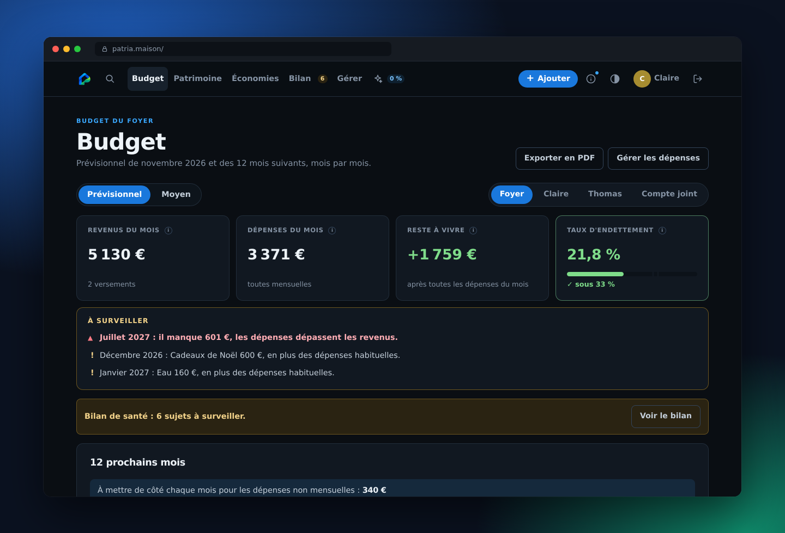
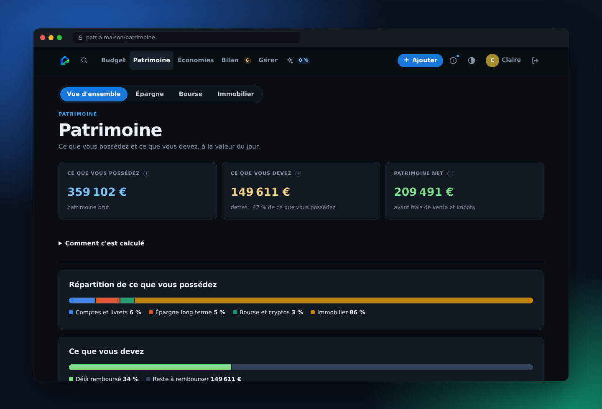
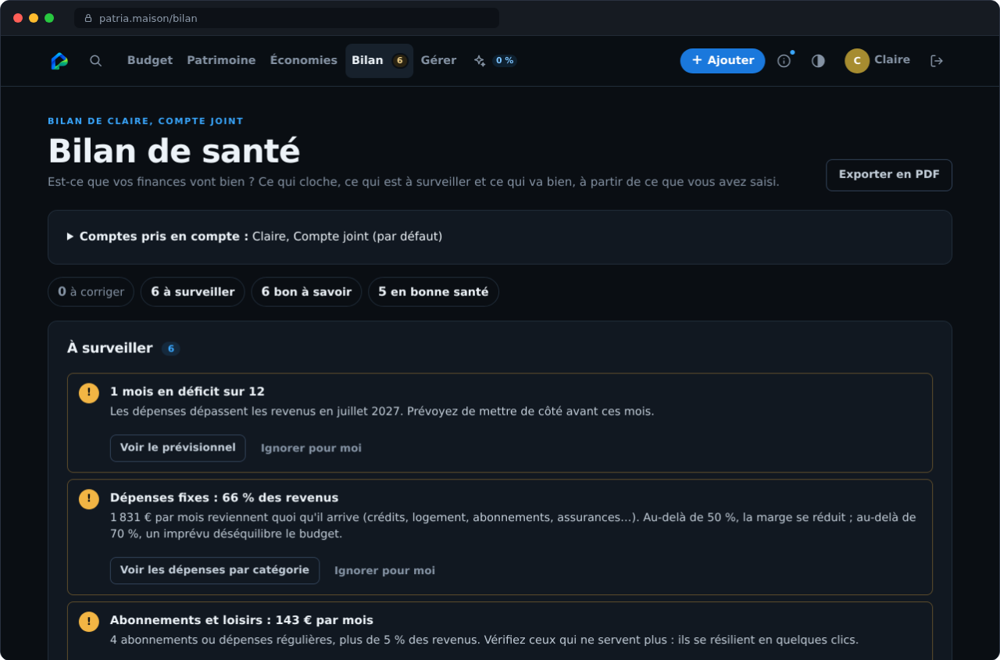
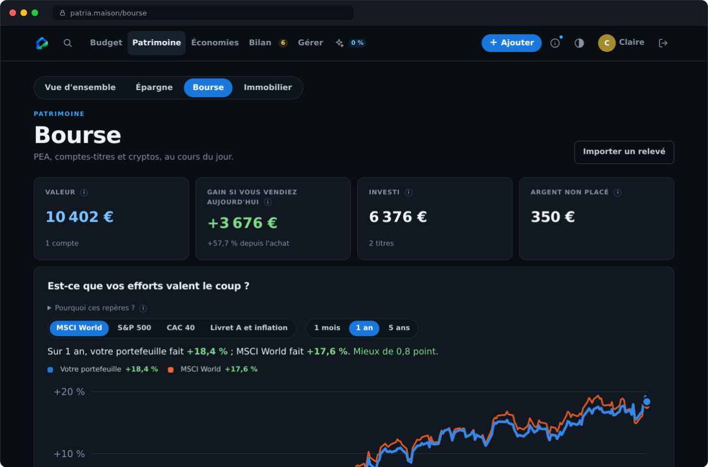
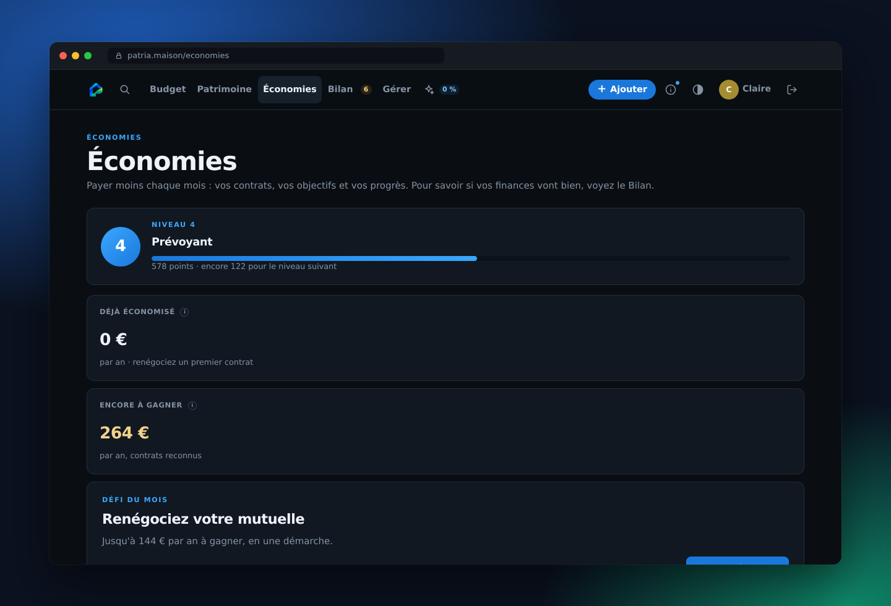
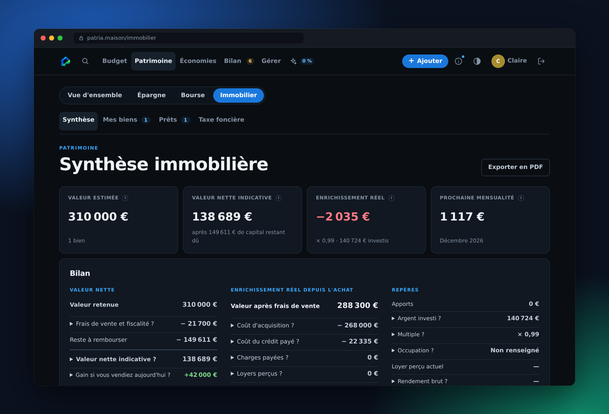
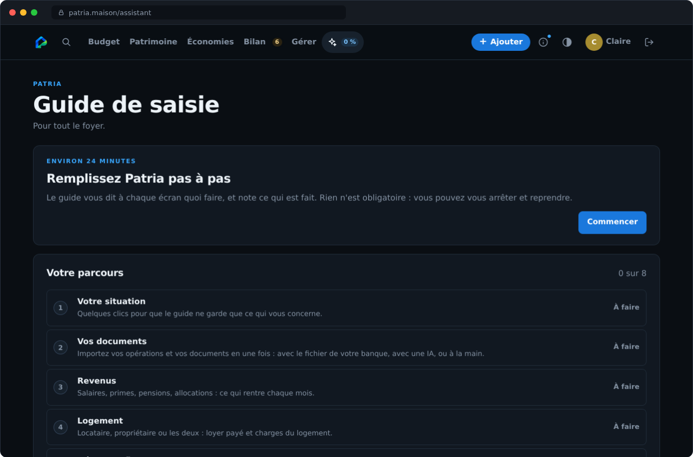

# Patria

**Savoir combien il vous reste chaque mois, préparer les grosses dépenses et comprendre ce que vous possédez, sans connecter vos comptes bancaires.**

Patria est une application web française, gratuite, que vous installez sur votre propre serveur. Elle réunit le budget de la famille, l'épargne, la bourse et l'immobilier, et explique les chiffres avec des mots simples.

## Ce que Patria vous apporte

- **Voir venir** : le budget des 12 prochains mois, les dépenses qui ne tombent pas tous les mois (assurance annuelle, vacances, Noël), les mois difficiles et la somme à mettre de côté chaque mois.
- **Savoir où va l'argent** : un mois type par catégorie, pour le foyer, chaque personne ou le compte joint.
- **Savoir si tout va bien** : le **Bilan de santé** passe vos finances en revue (épargne de précaution, endettement, abonnements, impôts, immobilier) et dit quoi corriger, avec un lien.
- **Payer moins** : la page **Économies** compare vos contrats (énergie, box, mobile, assurances, mutuelle, assurance de prêt) à des repères datés, avec la démarche pas à pas, et suit vos objectifs d'épargne.
- **Comprendre ce que vous possédez** : le **Patrimoine** additionne livrets, épargne, bourse et biens, retire ce que vous devez, et montre l'avancement du remboursement des prêts. En bourse, une question simple : « Est-ce que vos efforts valent le coup ? » face au MSCI World, au CAC 40 ou au Livret A.
- **Suivre vos biens** : prêts et reste à rembourser, charges et loyers repris dans le budget sans double saisie, comparaison aux ventes réelles du quartier (DVF), taux du marché pour une renégociation, synthèses PDF.
- **Commencer facilement** : un guide de saisie pas à pas, l'import du relevé de votre banque (CSV, OFX, QIF) ou de l'export de votre courtier. Une IA peut aider à préparer les fichiers, sans obligation.
- **Partager sans tout mélanger** : chacun a son compte ; le gestionnaire du foyer invite ses proches par e-mail et choisit ce que chacun voit.

Seul, en couple ou en famille, locataire ou propriétaire : le budget fonctionne sans bien immobilier. Une installation peut accueillir plusieurs foyers, chacun dans sa propre base.

| | |
|---|---|
|  |  |
| **Patrimoine** : possédé, dû, net, et l'avancement des prêts | **Bilan de santé** : ce qui va, ce qui est à surveiller |
|  |  |
| **Bourse** : vos placements face à un repère simple | **Économies** : vos contrats, vos objectifs, vos progrès |
|  |  |
| **Immobilier** : valeur, prêts et enrichissement réel | **Guide de saisie** : tout remplir pas à pas |

*Toutes les captures montrent un foyer fictif.*

## Choisir votre parcours

| Vous souhaitez… | Guide |
|---|---|
| Découvrir les écrans et renseigner votre budget | [Utiliser Patria](docs/utilisation.md) |
| Installer, sécuriser, sauvegarder ou mettre à jour | [Administrer Patria](docs/administration.md) |
| Comprendre ce qui reste local et ce qui sort | [Confidentialité et sécurité](docs/confidentialite.md) |
| Modifier le code ou publier une image | [Développement](docs/developpement.md) · [Architecture](ARCHITECTURE.md) |

## Vos données, avec des protections explicites

Pas de connexion bancaire, de publicité, de traceur ni de service d'analyse d'usage. Les données sont stockées sur le serveur de votre choix, et les PDF y sont produits sans service externe.

**Auto-hébergé ne signifie pas automatiquement sécurisé.** Configurez HTTPS pour l'accès distant et le chiffrement des bases **avant la première saisie**. Sans `DB_ENCRYPTION_KEY`, les fichiers restent lisibles ; après activation, perdre la clé rend les bases chiffrées irrécupérables. [Installation pas à pas](docs/administration.md#première-installation-docker).

Pour les données de marché, Patria transmet une adresse ou commune à l'API Adresse, des codes géographiques à DVF et une requête sans chiffres personnels à la BCE et à l'INSEE (inflation), et les codes des valeurs de bourse saisies à Yahoo Finance (jamais les quantités). Les IP de connexion sont transmises à ipwho.is pour la localisation de sécurité. Les e-mails (invitations, mot de passe oublié) passent par le serveur d'e-mails que vous réglez. `OFFLINE=true` coupe ces appels. Les liens Google Maps, carte DVF et Ko-fi ne sont ouverts que sur clic.

Les imports proposent un prompt à copier dans un assistant IA, dont la réponse se colle dans Patria ; Patria ne lui envoie rien. Attention aux données confiées à une IA commerciale. Avec une IA locale facultative (Ollama installé à côté), le document déposé est analysé sur votre serveur : rien ne sort.

Chacun crée son compte (inscription ou invitation) ; le gestionnaire de chaque foyer règle qui voit quoi, et le compte administrateur supervise sans consulter les finances dans l'interface. **L'exploitant du serveur peut techniquement lire les données** : choisissez un hébergeur de confiance. [Détails et limites](docs/confidentialite.md).

## Repères, pas conseil financier

Les prévisions dépendent de vos saisies. Les estimations DVF, taux, diagnostics et simulations sont indicatifs : ils ne remplacent pas une expertise immobilière, une offre bancaire ou un conseil fiscal. Il n'y a ni synchronisation bancaire ni import/export global JSON à ce jour.

## Installer

Les images Docker Hub sont disponibles pour `linux/amd64` et `linux/arm64` :

| Canal | Image | Publication |
|---|---|---|
| Stable, pour les utilisateurs | `supersouris7/patria:latest` ou `:X.Y.Z` | Après les tests d'un tag Git `vX.Y.Z` |
| Développement | `supersouris7/patria:unstable` | Chaque push sur `main`, après les tests |

`latest` ne suit jamais les pushs de développement : il désigne la plus grande version stable publiée. Il devient disponible après la première publication stable. Le Compose conserve `unstable` par défaut pour l'installation personnelle ; les utilisateurs choisissent `PATRIA_IMAGE=supersouris7/patria:latest` dans `.env`.

**Avant le premier lancement**, préparez le mot de passe administrateur, la clé de chiffrement et sa conservation : [guide administrateur](docs/administration.md).

## Soutenir

Patria est gratuit, sans abonnement ni publicité. Le lien facultatif « Soutenir Patria » ouvre Ko-fi sans charger de contenu tiers dans les pages. L'hébergement reste à votre charge.

## Licence

© 2026 William Iv. Patria est distribué sous la licence **[Elastic License 2.0](LICENSE)** ([traduction française](LICENSE.fr), pour information ; seul le texte anglais fait foi) :

- vous pouvez l'installer gratuitement pour vous, votre famille ou vos proches, le modifier et le redistribuer avec cette licence ;
- vous ne pouvez pas le proposer à des tiers comme **service hébergé ou géré** : ce service est réservé au titulaire des droits ;
- les mentions de droits et de licence ne doivent pas être retirées ; le nom « Patria » et son logo ne sont pas concédés.

Ce n'est pas une licence « open source » au sens de l'OSI. Les composants tiers conservent leurs propres licences. Chaque installation affiche la licence sur `/licence` et en pied de page.
