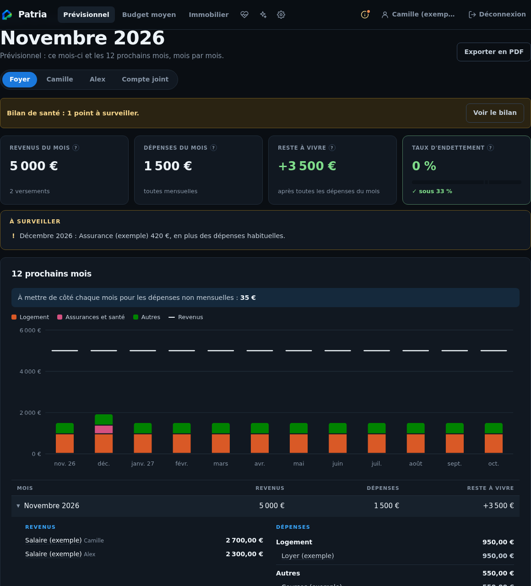

# Patria

**Anticipez votre budget et comprenez votre patrimoine immobilier, sans connecter vos comptes bancaires.**

Patria est une application web française gratuite, auto-hébergée. Elle réunit le budget du foyer et l'immobilier pour voir ce qui reste à vivre aujourd'hui, préparer les mois à venir et comprendre ce que rapportent réellement vos biens.

## Ce que Patria vous apporte

- **Anticiper plutôt que subir** : prévisionnel sur 12 mois, dépenses non mensuelles, mois en déficit et montant à mettre de côté.
- **Comprendre où va l'argent** : budget moyen par catégorie, revenus, dépenses récurrentes et bilan de santé avec liens pour corriger.
- **Partager sans tout mélanger** : budget du foyer, de chaque personne et du compte joint ; dépenses réparties selon vos choix, accès selon les droits accordés.
- **Relier budget et immobilier** : mensualités, charges et loyers repris automatiquement, sans double saisie ; prêts, capital restant dû et enrichissement réel.
- **Éclairer vos décisions** : comparaison aux ventes réelles du secteur (DVF), taux du marché et repère de renégociation, synthèses PDF.
- **Commencer accompagné** : guide de saisie, imports CSV et revue annuelle. L'IA peut aider à préparer les fichiers, mais reste facultative.

Locataire ou propriétaire, seul, en couple ou en famille : le budget fonctionne sans bien immobilier. Une installation peut accueillir plusieurs foyers avec des bases séparées.

*Exemple fictif : une dépense annuelle en décembre apparaît dans les prévisions et le montant mensuel à mettre de côté.*

## Choisir votre parcours

| Vous souhaitez… | Guide |
|---|---|
| Découvrir les écrans et renseigner votre budget | [Utiliser Patria](docs/utilisation.md) |
| Installer, sécuriser, sauvegarder ou mettre à jour | [Administrer Patria](docs/administration.md) |
| Comprendre ce qui reste local et ce qui sort | [Confidentialité et sécurité](docs/confidentialite.md) |
| Modifier le code ou publier une image | [Développement](docs/developpement.md) · [Architecture](ARCHITECTURE.md) |

## Vos données, avec des protections explicites

Pas de connexion bancaire, de publicité, de traceur ni de service d'analyse d'usage. Les données sont stockées sur le serveur de votre choix, et les PDF y sont produits sans service externe.

**Auto-hébergé ne signifie pas automatiquement sécurisé.** Configurez HTTPS pour l'accès distant et le chiffrement des bases **avant la première saisie**. Sans `DB_ENCRYPTION_KEY`, les fichiers restent lisibles ; après activation, perdre la clé rend les bases chiffrées irrécupérables. [Installation pas à pas](docs/administration.md#première-installation-docker).

Pour les données de marché, Patria transmet une adresse ou commune à l'API Adresse, des codes géographiques à DVF et une requête sans chiffres personnels à la BCE et à l'INSEE (inflation), et les codes des valeurs de bourse saisies à Yahoo Finance (jamais les quantités). Les IP de connexion sont transmises à ipwho.is pour la localisation de sécurité. `OFFLINE=true` coupe ces appels. Les liens Google Maps, carte DVF et Ko-fi ne sont ouverts que sur clic.

Les imports proposent un prompt à copier dans un assistant IA, dont la réponse se colle dans Patria ; Patria ne lui envoie rien. Attention aux données confiées à une IA commerciale. Avec une IA locale facultative (Ollama installé à côté), le document déposé est analysé sur votre serveur : rien ne sort.

Chacun crée son compte (inscription ou invitation) ; le gestionnaire de chaque foyer règle qui voit quoi, et le compte administrateur supervise sans consulter les finances dans l'interface. **L'exploitant du serveur peut techniquement lire les données** : choisissez un hébergeur de confiance. [Détails et limites](docs/confidentialite.md).

## Repères, pas conseil financier

Les prévisions dépendent de vos saisies. Les estimations DVF, taux, diagnostics et simulations sont indicatifs : ils ne remplacent pas une expertise immobilière, une offre bancaire ou un conseil fiscal. Il n'y a ni synchronisation bancaire ni import/export global JSON à ce jour.

## Installer

Les images Docker Hub sont disponibles pour `linux/amd64` et `linux/arm64` :

| Canal | Image | Publication |
|---|---|---|
| Stable, pour les utilisateurs | `supersouris7/patria:latest` ou `:X.Y.Z` | Après les tests d'un tag Git `vX.Y.Z` |
| Développement | `supersouris7/patria:unstable` | Chaque push sur `main`, après les tests |

`latest` ne suit jamais les pushs de développement : il désigne la plus grande version stable publiée. Il devient disponible après la première publication stable. Le Compose conserve `unstable` par défaut pour l'installation personnelle ; les utilisateurs choisissent `PATRIA_IMAGE=supersouris7/patria:latest` dans `.env`.

**Avant le premier lancement**, préparez le mot de passe administrateur, la clé de chiffrement et sa conservation : [guide administrateur](docs/administration.md).

## Soutenir

Patria est gratuit, sans abonnement ni publicité. Le lien facultatif « Soutenir Patria » ouvre Ko-fi sans charger de contenu tiers dans les pages. L'hébergement reste à votre charge. Aucune licence générale du code n'est actuellement déclarée dans ce dépôt : sa disponibilité publique ne suffit pas à le qualifier de logiciel libre. Les composants tiers conservent leurs propres licences.
