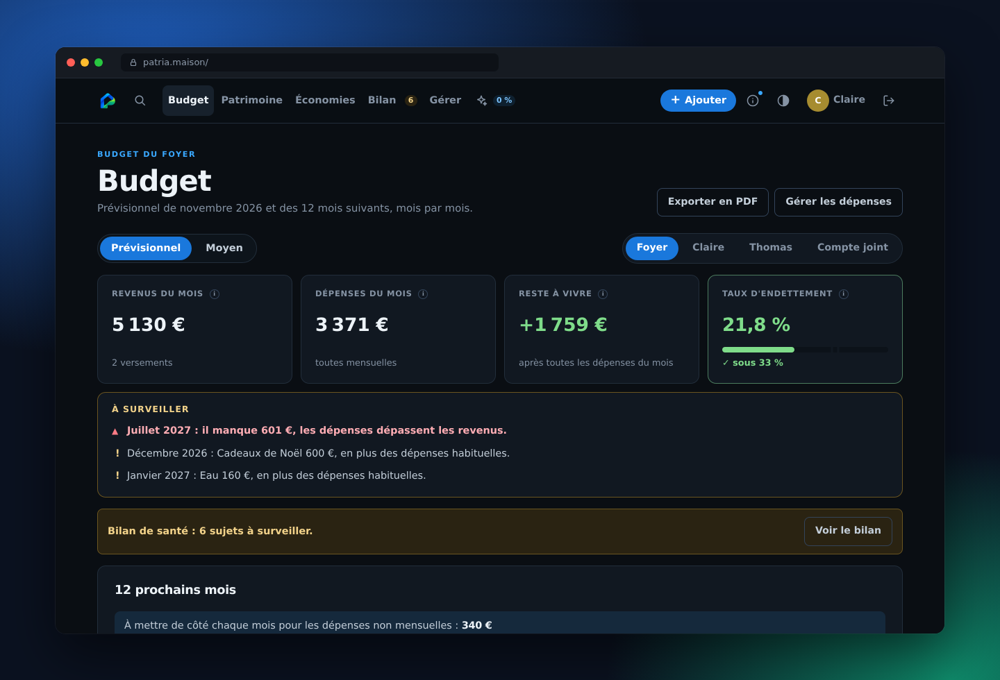
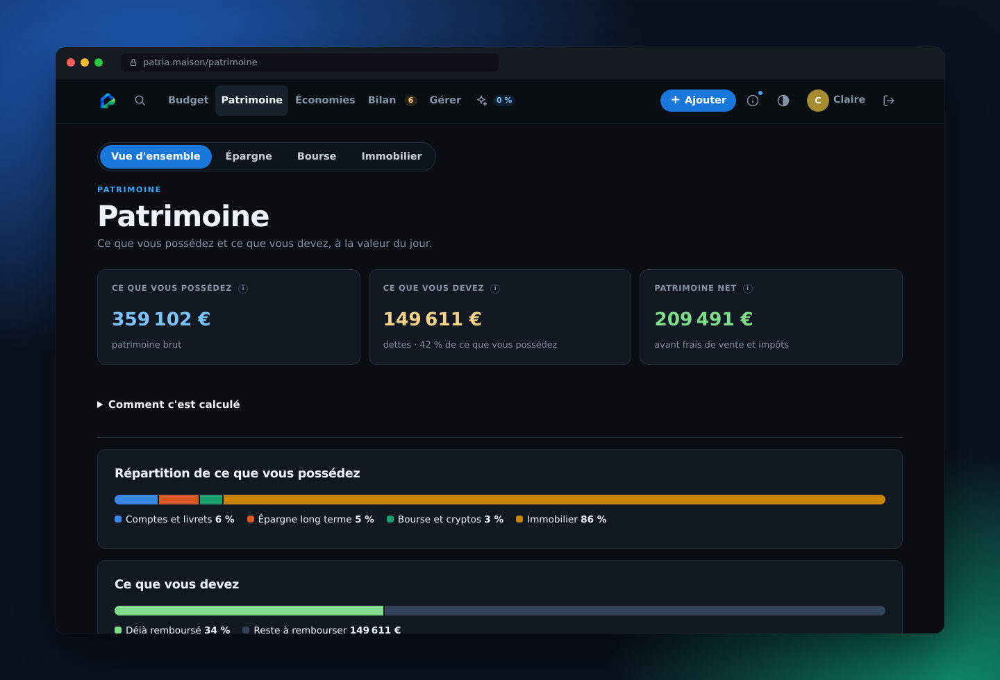
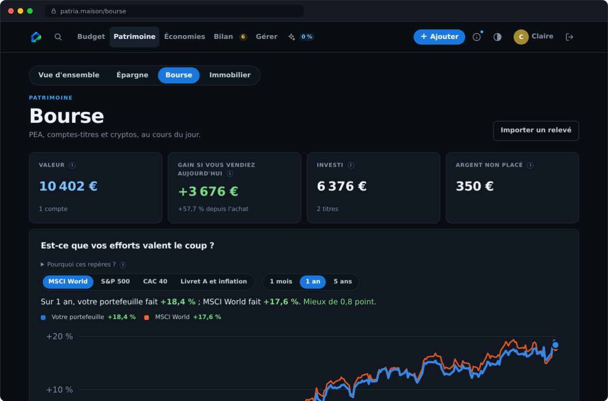
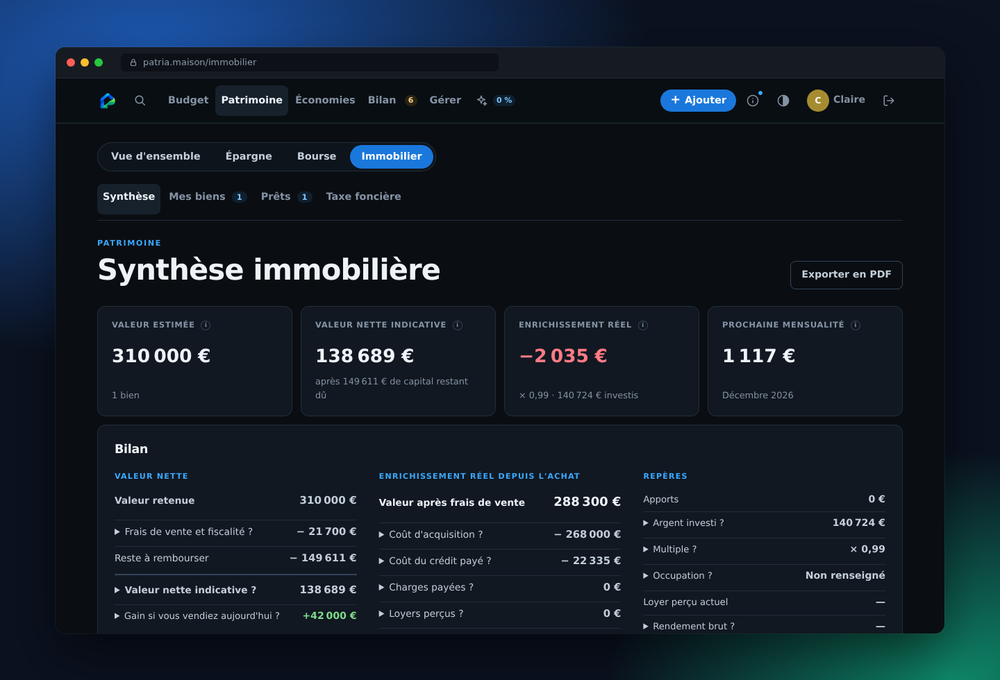
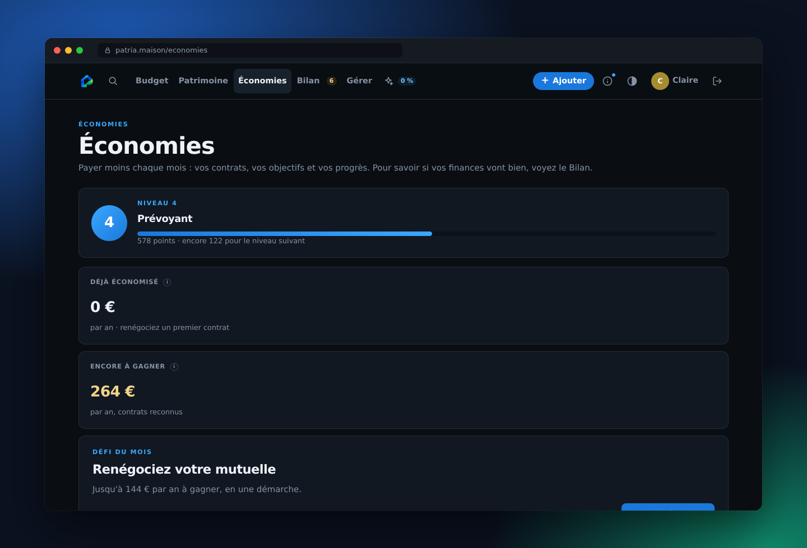
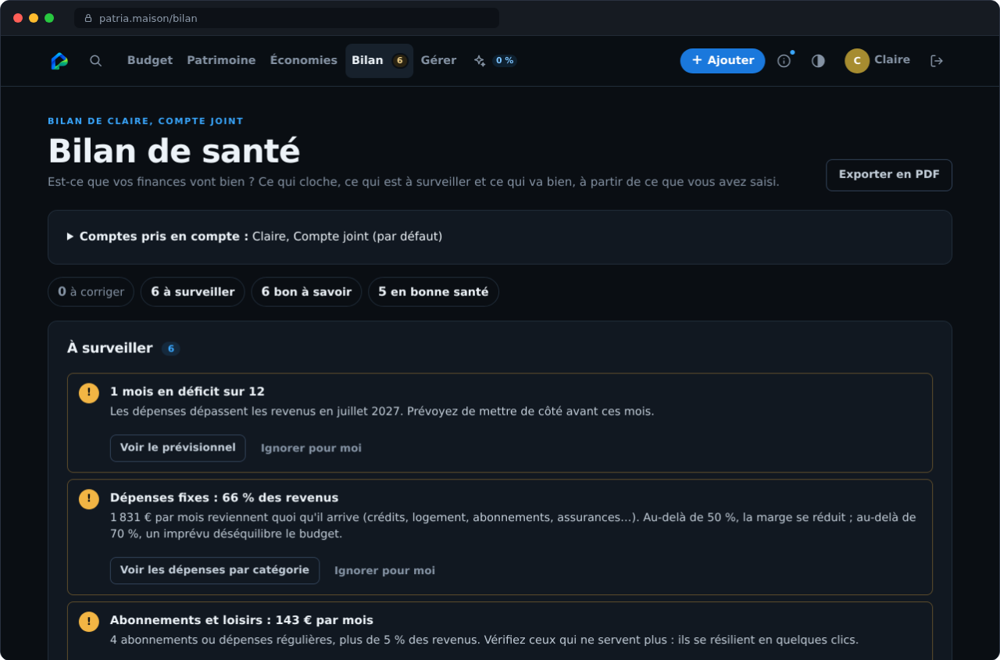

# Utiliser Patria

[Présentation](../README.md) · [Installation et administration](administration.md) · [Confidentialité](confidentialite.md)

Patria vous aide à savoir combien il vous reste chaque mois, à préparer les grosses dépenses et à suivre ce que vous possédez. Pas besoin de connecter une banque, ni d'avoir un bien immobilier : le budget fonctionne seul.

Les captures de cette page montrent un foyer fictif (Claire, Thomas et leur compte joint).

## Première connexion

**Créer son compte.** Chacun crée son propre compte :

- avec le **lien d'invitation** reçu du gestionnaire de votre foyer (par e-mail ou transmis à la main) : la page dit qui vous invite et ce que vous verrez, et vous arrivez avec ces droits ;
- ou avec **« Créer un compte »** sur la page de connexion, si les inscriptions sont ouvertes : vous créez votre foyer et vous en êtes le gestionnaire.

Quand l'installation sait envoyer des e-mails, l'**e-mail est obligatoire** : il sert à retrouver votre mot de passe. Un lien de confirmation vous est envoyé ; si vous créez votre compte avec l'adresse où vous avez reçu l'invitation, elle est confirmée d'office. Une barre d'étapes (Compte, E-mail, Sécurité, Découverte) vous accompagne : confirmation de l'e-mail si l'administrateur l'exige, proposition de double authentification, puis un écran d'accueil.

**La visite guidée.** « Visiter Patria » pose des bulles sur les vrais boutons de l'écran ; « Passer » l'évite. Mon compte → « Revoir la visite guidée » la relance.

**Qui est qui :**

| Mot | Ce que c'est |
|---|---|
| **Membre** | Une personne du budget (vous, votre conjoint, un enfant) ou un compte joint. |
| **Utilisateur** | Un compte de connexion. Un membre n'a pas forcément de compte. |
| **Gestionnaire** | Gère les membres du foyer, invite les autres et règle qui voit quoi (Gérer → Mon foyer et les droits). Un foyer peut en avoir plusieurs. |
| **Administrateur** | S'occupe de l'installation et dépanne les comptes. Il ne voit pas vos finances dans l'interface. |

**Qui voit quoi.** Pour chaque compte, le gestionnaire coche les membres visibles, les **totaux du foyer**, l'**immobilier** et le rôle de **gestionnaire**. Chaque case donne l'accès complet (voir et modifier). Une ligne partagée avec un membre que vous ne voyez pas est en lecture seule ; dans les totaux, elle s'affiche « Ligne masquée ». L'icône « i » de l'en-tête (« Qui voit quoi ») résume les accès du foyer et signale par un point les changements récents. Ces réglages ne protègent pas contre l'exploitant du serveur : [limites](confidentialite.md).

## Se repérer

L'en-tête est le même sur toutes les pages :

- à gauche : le logo, la **loupe** de recherche, puis **Budget**, **Patrimoine**, **Économies**, **Bilan** (avec le nombre de points à traiter), **Gérer** et l'icône étincelles du **Guide de saisie** (avec son pourcentage d'avancement) ;
- à droite : **+ Ajouter**, l'icône « i » **Qui voit quoi**, le **thème** clair / sombre, votre **avatar** (Mon compte) et la déconnexion.

**+ Ajouter** est l'unique point d'entrée pour saisir quelque chose : un relevé bancaire, une dépense, un revenu, un livret ou un placement, un titre en bourse, un virement entre membres, un bien immobilier, un objectif d'épargne. Il ouvre directement le bon formulaire ; les pages, elles, servent à consulter.

La **recherche** retrouve les pages et vos biens, sans tenir compte des accents. Sur tablette, les pages passent dans le **menu** (trois traits) ; sur téléphone, le menu contient aussi la recherche et Mon compte, et sa pastille compte vos notifications (alertes du Bilan, changements d'accès). Sur téléphone, les tableaux deviennent des fiches, une par ligne.

**Gérer** rassemble les listes et réglages : Mon foyer et les droits, Revenus, Dépenses, Virements, Biens et prêts, Répartition. Si vous avez plusieurs foyers, choisissez-le dans Gérer.

Les montants sont arrondis à l'euro dans les tuiles et les phrases, au centime dans les listes et les formulaires. Le bouton **thème** passe de « système » à clair, puis sombre ; le choix est gardé sur l'appareil.

## Budget



Le **Budget** répond à une question : combien me reste-t-il ? En haut, choisissez :

- **Prévisionnel** : le mois en cours et les 12 suivants, mois par mois. Les dépenses qui ne tombent pas tous les mois (assurance annuelle, cadeaux de Noël, vacances) apparaissent le mois où elles tombent, et Patria indique **combien mettre de côté chaque mois** pour les absorber ;
- **Moyen** : un mois type, par catégorie, toutes les dépenses ramenées au mois.

À droite, choisissez le budget de tout le **foyer**, d'une personne ou du **compte joint**. Les tuiles donnent les revenus, les dépenses, le **reste à vivre** (ce qui reste après toutes les dépenses du mois) et le **taux d'endettement** (la part des revenus qui part en crédits, à garder sous 33 %). En dessous, **À surveiller** liste les mois difficiles.

**Montants qui changent.** Quand un salaire ou un abonnement change, modifiez-le dans Gérer : « Nouveau montant valable à partir du » est prérempli au 1er du mois prochain, et l'ancien montant reste avant cette date (utile pour l'historique et le pouvoir d'achat). Videz ce champ pour corriger une simple faute de frappe.

## Guide de saisie


L'icône étincelles ouvre le **Guide de saisie**, qui vous fait tout remplir pas à pas. Un seul bouton : **Commencer**, puis **Continuer** là où vous en êtes, avec le temps restant estimé. « Tout revoir », « Revue annuelle » et « Recommencer à zéro » sont dans **Autres actions**.

1. **Votre situation** (gestionnaire) : cinq questions à cliquer (seul ou en couple, compte joint, logement, autres biens, épargne). Le guide ne garde ensuite que les étapes qui vous concernent, et crée les personnes du budget.
2. **Vos documents** : la façon la plus rapide de tout remplir (voir ci-dessous).
3. Puis, selon votre situation : **Revenus**, **Logement**, **Biens**, **Prêts**, **Charges et loyers des biens**, **Dépenses fixes**, **Impôts**, **Virements**, **Répartition**, **Épargne et bourse**, et le **Récapitulatif**.

Chaque étape indique « Étape 3 sur 8 · Revenus · environ 17 min pour finir le guide », puis **À faire ici** : ce qu'il reste à saisir, coché au fur et à mesure. Dans les listes de dépenses, cochez ce que vous payez, indiquez le montant, la fréquence, la date et qui paie. Les lignes déjà saisies se modifient ou se suppriment juste au-dessus. Une étape laissée vide est notée « à compléter » et le récapitulatif y renvoie.

Tant que le guide n'est pas fini, une barre en haut des pages propose de continuer ; « × » la masque. L'avancement est propre à chaque compte. « Recommencer à zéro » efface l'avancement, pas vos données. Un compte qui n'est pas gestionnaire suit un guide réduit à ses propres lignes.

### Remplir Patria depuis vos documents

À l'étape **Vos documents**, trois façons, au choix :

- **Avec le fichier de votre banque** (le plus simple, sans IA) : sur le site de la banque, liste des opérations → « Exporter » ou « Télécharger » → CSV (ou OFX, QIF), sur 3 à 12 mois. Déposez-le : Patria repère les prélèvements et revenus qui reviennent. Vous pouvez aussi **glisser le fichier sur n'importe quelle page**. Le résultat s'affiche tout de suite (« 214 opérations lues, 12 régulières trouvées ») avec un bouton **Valider maintenant**. Les opérations déjà importées ne reviennent pas. Si vous avez indiqué votre banque, Patria vous propose chaque mois d'importer le nouveau relevé.
- **Avec une IA** (Le Chat, ChatGPT, Claude, Gemini…) : « Copier la consigne », collez-la dans l'IA avec vos documents, puis collez toute sa réponse dans Patria.
- **À la main** : le guide passe directement aux écrans de saisie.

« Quels documents rassembler, et où les trouver ? » liste les documents utiles et, banque par banque, où les télécharger.

Ensuite, chaque étape commence par ses lignes **À trier**, cochées d'avance (sauf les doublons possibles, les abonnements résiliés et ce qui est déjà saisi). « Valider la sélection » enregistre ce qui est coché.

**Attention à ce que vous confiez à une IA commerciale** : elle reçoit tout ce que vous lui envoyez (noms, adresses, IBAN, montants) et peut, selon ses conditions, le garder ou s'en servir pour s'entraîner. Retirez les informations sensibles et réglez l'assistant avant d'envoyer (conversation temporaire, entraînement refusé, pas de lien de partage, mémoire désactivée) : [comment faire](confidentialite.md#régler-lassistant-ia-avant-denvoyer). Si l'administrateur a installé une **IA locale**, vous pouvez à la place **déposer le document** (PDF avec du texte, CSV ou texte) : il est lu sur votre serveur, sans rien envoyer à l'extérieur. Comptez quelques minutes ; un scan sans texte n'est pas lisible.

## Patrimoine



La page **Patrimoine** répond à : qu'est-ce que je possède vraiment ? Ses onglets : **Vue d'ensemble**, **Épargne**, **Bourse**, **Immobilier**.

La vue d'ensemble donne trois chiffres :

- **Ce que vous possédez** : comptes et livrets, épargne long terme, bourse et cryptos, biens à leur valeur retenue ;
- **Ce que vous devez** : ce qu'il reste à rembourser sur les prêts immobiliers ;
- **Patrimoine net** = ce que vous possédez − ce que vous devez : ce qui vous resterait si vous remboursiez toutes vos dettes aujourd'hui, sans rien vendre.

En dessous, une barre montre la **répartition** de ce que vous possédez, puis une barre **Ce que vous devez** montre la part déjà remboursée de tous vos prêts (moyenne pondérée par leur montant), avec le taux moyen et la date de fin du dernier prêt. Les biens sont comptés avant frais de vente et impôts. Les crédits à la consommation ne sont pas comptés : seule leur mensualité est connue. L'immobilier n'apparaît que pour qui y a accès.

### Épargne

Les placements de chaque membre : compte courant, Livret A, LDDS, LEP, livret jeune, CEL, PEL, assurance-vie, PER… Un placement appartient à un membre : le voient ceux qui voient ce membre. Saisissez le solde, puis mettez-le à jour quand il change.

- **Taux** : ceux des livrets réglementés sont fournis et datés par Patria (source service-public.gouv.fr). Pour une assurance-vie ou un livret bancaire, saisissez-le.
- **Versement programmé** : un montant par mois fait avancer le solde tout seul (plafonds respectés) et apparaît dans le budget.
- **Tuiles** : épargne totale, **épargne de précaution** (en mois de dépenses), **hausse des prix** sur 12 mois (INSEE) et **vos intérêts** : le taux moyen de votre épargne et ce qu'il reste une fois la hausse des prix déduite. En rouge, votre épargne perd du pouvoir d'achat.
- **Plan d'épargne de sécurité** : l'objectif (6 mois de dépenses par défaut), ce qui manque, un versement mensuel conseillé et l'ordre de remplissage (LEP si vous y avez droit, Livret A, LDDS, puis le long terme).
- **Hausse des prix et taux des livrets** : un graphique sur deux ans compare l'inflation au Livret A, au LEP et à votre taux moyen.
- **Historique** : les 24 derniers mois en barres (disponible, bourse, long terme).
- **Revenu fiscal de référence** : saisi ici ou à l'étape Impôts du guide. Avec le nombre de parts, Patria sait seul si vous avez droit au LEP.

### Bourse



Le PEA, les comptes-titres et les cryptos ont leur propre page, parce que leur valeur peut baisser.

- **Tuiles** : valeur au cours du jour, **gain si vous vendiez aujourd'hui** (rien n'est gagné ni perdu tant que vous ne vendez pas), montant investi, **argent non placé** (les espèces chez le courtier).
- **Est-ce que vos efforts valent le coup ?** Votre portefeuille face à un repère simple : MSCI World, S&P 500, CAC 40, ou Livret A et inflation, sur 1 mois, 1 an ou 5 ans. Une phrase donne le verdict (« Sur 1 an, votre portefeuille fait +18,4 % ; MSCI World fait +17,6 %. Mieux de 0,8 point. »). « Pourquoi ces repères ? » explique chacun, et pourquoi il faut faire mieux que l'inflation. Indices hors dividendes, portefeuille à sa composition actuelle.
- **Importer un relevé** : choisissez le courtier (les étapes pour obtenir l'export sont rappelées) et déposez le fichier tel quel (Trade Republic, Degiro, Revolut, BoursoBank, Binance, Coinbase…). Patria reconnaît les colonnes, cumule achats et ventes et montre un aperçu ; redéposer un export récent met les lignes à jour. Avec l'export complet de Trade Republic, les espèces sont aussi calculées.
- **Ajouter un titre** (par + Ajouter) : cherchez-le par son nom, son ISIN ou son code (« MSCI World », `FR0010315770`, `BTC`), puis indiquez la quantité et le prix moyen par part.
- **Ce que vos placements ont vraiment rapporté** : avec des relevés importés, la valeur des titres moins ce que vous avez versé (achats − ventes).

Chaque titre se déplie sur la courbe de son cours, avec votre prix moyen en pointillé. Les cours viennent de Yahoo Finance, en différé ; une valeur en dollars est convertie en euros.

### Immobilier



Un compte avec l'accès Immobilier crée les biens (type, adresse, surface, achat, estimations, frais de vente), leurs prêts et leurs apports. Les onglets : **Synthèse**, **Mes biens**, **Prêts**, **Taxe foncière**.

**À qui appartient un bien.** Un bien appartient à **un seul foyer**, avec ses prêts, charges et loyers. La part de chacun et le payeur de la taxe foncière se règlent dans Gérer → Répartition. L'accès Immobilier ouvre tous les biens du foyer ; sans lui, les mensualités et charges comptent quand même dans votre budget. Un compte qui a l'immobilier dans deux foyers peut déplacer un bien de l'un à l'autre.

**Valeur.** Vous donnez une estimation prudente et une optimiste ; Patria les actualise avec l'indice des ventes du département. Choisissez la **valeur retenue** : prudente, prix du marché (prix médian du m² de la commune × surface), fourchette, optimiste ou libre. La **valeur nette indicative** = valeur − frais de vente − reste à rembourser.

**Prêts.** Importez le tableau d'amortissement (voir le format plus bas). Patria calcule à la date du jour le **reste à rembourser**, le taux, la prochaine échéance, les intérêts payés et à payer. Sur la fiche du prêt, Patria compare votre taux à la moyenne actuelle des nouveaux prêts (Banque de France) : mensualité au taux du marché, économie d'intérêts, puis économie après pénalités de remboursement anticipé. À partir de 0,7 point d'écart, demander une simulation à votre banque peut valoir le coup. Ce n'est pas une offre bancaire.

**Charges, location, rentabilité.** Saisissez les charges par année (taxe foncière, copropriété, assurance…) ; une seule année suffit, la taxe foncière est revalorisée chaque année. Indiquez les périodes de location (loyer perçu) ou d'habitation (loyer économisé). L'**enrichissement réel** = valeur après frais de vente − prix d'achat − coût du crédit − charges + loyers. C'est un repère, pas un calcul fiscal.

**Prix au m² et ventes du secteur.** Patria compare votre bien aux ventes réelles proches (données publiques DVF) : même type, surface comparable, 3 dernières années, dans un rayon de 500 m à 2 km puis la commune. Vous obtenez le prix médian, la fourchette, 5 ventes comparables et une page détaillée avec carte. Pas de données en Alsace-Moselle ni à Mayotte. Hors ligne, le reste de Patria fonctionne, mais le marché n'est plus actualisé.

## Économies



La page **Économies** répond à : comment payer moins ? Pour savoir si vos finances vont bien, c'est le **Bilan**.

- **Déjà économisé** (contrats renégociés, sur un an) et **Encore à gagner** (l'écart entre vos contrats et des offres courantes).
- **Le défi du mois** : la seule chose la plus utile à faire maintenant.
- **Vos contrats**, reconnus dans vos dépenses : électricité, gaz, eau, box, mobile, assurances, mutuelle (selon votre âge), frais bancaires, abonnements, et l'**assurance de chaque prêt**. Chacun est comparé à un repère daté et sourcé, avec le gain possible par an et la démarche pas à pas (comparateur officiel énergie-info.fr, loi Hamon, loi Lemoine, portabilité du numéro, mobilité bancaire). « J'ai renégocié » (ou « J'ai changé d'assurance » pour un prêt) enregistre le nouveau montant : le budget le prend le mois suivant et l'économie s'ajoute au compteur.
- **Objectifs d'épargne** (vacances, voiture, travaux…), qui se remplissent avec le solde du livret choisi. On en ajoute par + Ajouter.
- **Votre niveau**, vos **points**, **missions**, **séries** (mois d'affilée sans déficit, avec un relevé importé, avec une épargne en hausse) et **badges** : chaque chose utile faite rapporte des points. Le niveau s'affiche au survol de votre avatar.

Les repères sont indicatifs ; rien n'est envoyé à un comparateur.

## Bilan de santé



Le **Bilan** répond à : est-ce que mes finances vont bien ? Une ligne de pastilles résume les points **à corriger**, **à surveiller**, **bon à savoir** et **en bonne santé** ; un clic mène à la liste. Chaque point explique le problème en clair et propose un lien pour le régler.

Il regarde :

- **le budget** : reste à vivre, mois en déficit, endettement, part des dépenses fixes, abonnements, grosses dépenses à mensualiser, virements qui ne couvrent pas le compte joint, salaires pas mis à jour ;
- **l'épargne** : précaution, argent qui dort sur le compte courant, plafonds atteints, LEP possible, livrets qui rapportent moins que la hausse des prix, trop d'argent sur une seule action, PEA de moins de 5 ans ;
- **l'immobilier** : estimations anciennes, occupation, rendement, taux des prêts ;
- **les impôts** : prélèvement à la source, taxe foncière, loyers à déclarer, repère IFI ;
- **les contrats** où un gain est possible (page Économies).

Par défaut, il porte sur votre compte et les comptes joints que vous voyez ; changez-le dans **Comptes pris en compte**. **Ignorer pour moi** retire un point des compteurs, pour vous seul ; **Points ignorés** → **Rétablir** le remet. Un point qui s'aggrave réapparaît.

**Votre évolution**, en bas du Bilan :

- **Note de santé sur 100** et ce qui la compose (bilan, budget complet, épargne de précaution), avec sa courbe mois après mois ;
- **pouvoir d'achat** : vos revenus réguliers comparés à la hausse des prix. Avec moins d'un an de revenus saisis, Patria suppose qu'ils étaient les mêmes avant ;
- **patrimoine net**, **reste à vivre**, **dépenses prévues face aux réelles** (avec les relevés importés) et **revenu fiscal de référence** par année.

Le patrimoine, le reste à vivre, le prévu/réel et la note ne s'affichent qu'à qui voit tout le foyer. Ce diagnostic est un repère, pas un conseil fiscal ou financier.

## Revue annuelle et historique

**Revue annuelle** (Guide de saisie → Autres actions) : pour chaque revenu et dépense, nouveau montant et date, ou arrêt ; avec l'immobilier, taxe foncière de l'année et estimations des biens. Le Budget la rappelle après un an.

Patria garde un **historique** sans détail, dans la base chiffrée du foyer : un relevé par mois (revenus, dépenses, épargne, bourse, immobilier, dettes, note), les 36 mois passés reconstitués à la première visite, l'indice des prix INSEE (pour calculer le pouvoir d'achat même hors ligne), le revenu fiscal de référence année par année, les totaux des dépenses réelles des relevés (sans aucun libellé), les achats et ventes de bourse, et les estimations successives de chaque bien.

## Mon compte

- **Profil** : prénom et nom, date de naissance (utile pour comparer la mutuelle), téléphone, et le membre du budget que vous êtes. Votre **avatar** montre vos initiales ou une photo, recadrée et nettoyée de ses métadonnées (lieu, appareil) ; seuls les comptes de vos foyers et l'administrateur la voient.
- **E-mail** : changer d'adresse envoie un lien de confirmation. Une adresse confirmée permet « Mot de passe oublié » sur la page de connexion.
- **Mot de passe** et **double authentification** : scannez le QR code avec une application (Aegis, 2FAS, Google Authenticator…), puis tapez le code. Cochez « Se souvenir de cet appareil 30 jours » sur vos appareils. Téléphone perdu : l'administrateur peut la retirer.
- **Connexions** : vos 10 dernières, réussies ou non, avec le lieu. Une connexion inconnue : changez de mot de passe et activez la double authentification.
- **Accès API** : un jeton en lecture seule pour un tableau de bord (Homepage, Homarr, Dashy). `GET /api/v1/resume` avec `Authorization: Bearer patria_…` renvoie en JSON le reste à vivre du mois, l'épargne, le patrimoine net, le nombre d'alertes et l'avancement du guide, avec vos droits. Le jeton ne s'affiche qu'une fois et se révoque à tout moment.

La session se ferme au bout de 12 heures.

## Inviter vos proches (gestionnaires)

Gérer → Mon foyer et les droits → **Inviter quelqu'un** : choisissez le membre du budget (ou un nouveau, à son prénom), les cases (totaux du foyer, immobilier, gestionnaire) et, si l'installation envoie des e-mails, l'adresse de la personne. Elle reçoit un lien valable 7 jours et une seule fois ; l'e-mail dit qui l'invite et ce qu'elle verra. Le lien s'affiche aussi à l'écran, pour le transmettre vous-même si l'e-mail n'arrive pas. Une invitation en attente peut être **renvoyée** (un nouveau lien remplace l'ancien) ou **annulée**. Si les inscriptions sont fermées par l'administrateur, seule une personne qui a déjà un compte peut encore accepter.

## Formats d'import

### Dépenses (CSV)

Gérer → Dépenses → Importer. **Pas de ligne d'en-tête** ; colonnes dans cet ordre :

```text
libelle;categorie;montant;frequence;debut;fin
```

Exemple de contenu :

```csv
Mutuelle;Santé;35,69;Mensuel;01/01/2026;
Assurance emprunteur;Crédits;17,68;Mensuel;01/01/2026;05/09/2042
```

- Fin facultative. Dates `31/01/2026` ou `2026-01-31`.
- 7e colonne facultative, des **repères** séparés par des virgules (Abonnement, Télécom, Ponctuel, Doublon possible, Résilié, À vérifier…) ; la consigne IA les fait remplir.
- Catégorie et fréquence : les noms affichés dans Patria (accents et majuscules indifférents) ou les codes (`HEALTH`, `MONTHLY`).
- Montants avec virgule ou point, espaces et « € » acceptés. Point-virgule conseillé ; 500 lignes au plus.

L'aperçu a une case par dépense et des boutons pour cocher ou décocher par groupe (Tout, Rien, Télécom, Doublon possible, par catégorie). Les doublons possibles et les abonnements résiliés sont décochés d'avance. La répartition se choisit pour tout le fichier, puis ligne par ligne. Une dépense déjà saisie (même libellé, montant, fréquence et début) est ignorée. Une erreur bloque l'import sans rien enregistrer.

### Tableau d'amortissement d'un prêt (CSV)

Prêts du bien → Ajouter un prêt, ou Gérer le prêt pour remplacer le tableau. CSV UTF-8, 1 Mio au plus. **Un import remplace toutes les anciennes lignes de ce prêt.**

```csv
date,type,montant,capital_rembourse,interets,frais,capital_restant_du,taux_annuel_pct
```

`date` et `type` sont obligatoires, plus au moins un montant par ligne. Types : `DEBLOCAGE`, `ECHEANCE`, `REMBOURSEMENT_ANTICIPE`, `CONSOLIDATION`, `AJUSTEMENT`. Virgule ou point-virgule ; décimales avec point ou virgule. [Trois exemples](examples/) sont fournis. Une consigne IA aide à convertir le PDF de la banque : vérifiez toujours les dates et montants obtenus.

La copie automatique d'une consigne IA demande HTTPS (ou localhost) ; sinon, sélectionnez le texte et faites Ctrl+C.

## Synthèses PDF

« Exporter en PDF » produit une synthèse A4 de la page, avec vos droits : Budget prévisionnel et moyen, Immobilier, un bien (avec les ventes comparables), un prêt (années et échéancier), Bilan de santé. Les PDF sont produits sur votre serveur, sans service extérieur. Ils contiennent des données financières : protégez-les avant de les partager. Il n'y a pas d'export global des données à ce jour.
