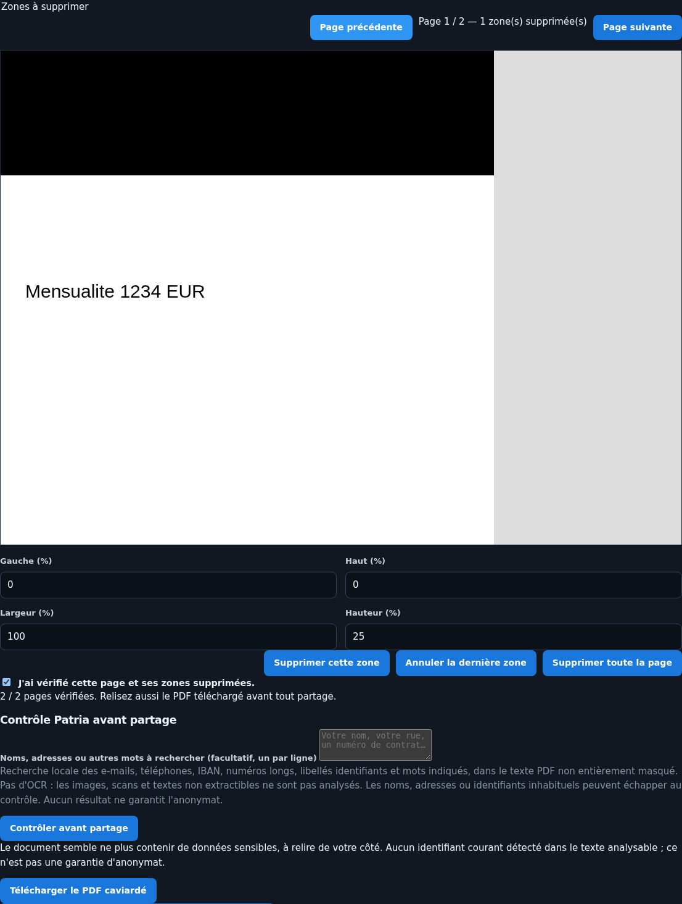

# Utiliser Patria

[Présentation](../README.md) · [Installation et administration](administration.md) · [Confidentialité](confidentialite.md)

Patria vous aide à prévoir votre reste à vivre, répartir les dépenses et suivre votre immobilier. Pas besoin de connecter une banque ni de posséder un bien pour utiliser le budget.

## Première connexion

L'administrateur de l'installation crée votre compte et les accès à votre foyer. Changez le mot de passe provisoire dès la première connexion. Quatre écrans présentent Patria, les foyers, la confidentialité et le soutien au développement.

Un **membre** est une personne du budget ou un compte joint. Un **utilisateur** est un compte de connexion. Un **gestionnaire** renseigne tout son foyer. L'**administrateur** gère l'installation, les comptes et les droits, pas les finances dans l'interface.

- Un utilisateur consulte les membres et vues qui lui sont ouverts ; les totaux du foyer et l'immobilier ne sont pas automatiquement visibles.
- Il modifie les revenus, dépenses et virements qui ne concernent que ses vues ; une ligne partagée avec un autre membre est en lecture seule.
- Le gestionnaire voit et modifie tout son foyer, y compris les biens et la répartition. Il ne crée pas de compte ni ne règle les droits.
- L'icône jaune « qui voit quoi », à côté du foyer, indique les accès et leurs changements récents. Cela ne protège pas contre l'exploitant du serveur : [limites de confidentialité](confidentialite.md).

Sélectionnez le foyer dans l'en-tête si vous en avez plusieurs. Mon compte permet de changer le mot de passe. Déconnexion ferme la session ; elle expire au bout de 12 heures.

**Connexions.** Mon compte liste vos 10 dernières connexions, réussies ou non, avec l'adresse IP et le lieu. Une connexion que vous ne reconnaissez pas : changez votre mot de passe et activez la double authentification. Il n'y a plus de bouton horloge dans la barre de navigation.

**Navigation et consultation.** Sur ordinateur, une seule ligne regroupe Patria, Budget (Prévisionnel, Budget moyen), Immobilier (Patrimoine, Mes biens, Prêts, Taxe foncière), Bilan de santé et Assistant. À droite : Qui voit quoi (jaune), Gérer, votre compte et la déconnexion. Les panneaux prennent toute la largeur sous la barre ; leur champ de recherche filtre les entrées, sans tenir compte des accents. « Mes biens » affiche les biens dans le même panneau, sans menu en cascade. Sur petit écran, le bouton Menu remplace les rubriques centrales. Dans Gérer se trouvent le sélecteur de foyer et les saisies autorisées ; pour l'administrateur, Foyers, Utilisateurs et Sécurité, sans accès aux finances. Les listes viennent avant les formulaires : ouvrez « Ajouter… » ou « Importer… » lorsque nécessaire. Une erreur de saisie rouvre le formulaire. Les aides des indicateurs s'ouvrent par appui, ou avec Entrée au clavier. Dans Foyers, ouvrez un foyer pour modifier ses membres et son gestionnaire.

**Double authentification.** Mon compte → « Activer la double authentification » : scannez le QR code avec une application d'authentification (Aegis, 2FAS, Google Authenticator…), puis tapez le code affiché. Ensuite, la connexion demande ce code après le mot de passe ; cochez « Se souvenir de cet appareil 30 jours » sur vos appareils personnels. Téléphone perdu : demandez à l'administrateur de la retirer ; Patria vous le signalera.

## Commencer avec le Guide de saisie

L'icône étincelles ouvre un parcours guidé :

1. Documents à rassembler : salaires, impôts, relevés, échéanciers, taxes foncières, contrats et abonnements.
2. Membres ; 3. Revenus ; 4. Logement (locataire : loyer, charges, assurance).
5. Biens ; 6. Prêts ; 7. Charges et loyers des biens.
8. Dépenses fixes, par thème : énergie, télécoms, enfants, transports, santé, assurances, crédits, vie courante.
9. Impôts ; 10. Virements ; 11. Répartition ; 12. Récapitulatif.

Chaque étape explique le chiffre attendu et ce que Patria reprend déjà, pour éviter les doublons. Les étapes non pertinentes peuvent être passées. « Reprendre » saute les étapes faites ou passées ; « Tout revoir » les affiche avec les données existantes ; « Recommencer à zéro » efface **la progression, pas les données**. La progression est propre au compte. Les lignes déjà saisies ne sont pas recréées ; les saisies par personne restent proposées avec l'existant.

Un utilisateur non gestionnaire dispose des étapes correspondant à ses droits. Le gestionnaire renseigne aussi les membres, biens et répartitions. Le bandeau de progression du Prévisionnel permet de reprendre la configuration ou de masquer ce rappel.

## Budget : ce qui rentre, ce qui sort, ce qui reste

### Prévisionnel

La page d'accueil montre les revenus, dépenses, reste à vivre du mois et les 12 prochains mois. Cliquez sur un mois du graphique pour son détail ; chaque ligne mène à sa saisie lorsque vos droits le permettent. Les dépenses non mensuelles à venir, mois déficitaires et montant à mettre de côté aident à anticiper.

Les revenus sont saisis **nets avant impôt** : salaire mensuel, primes et 13e mois annuels, revenus ponctuels. Les dépenses ont un montant, une fréquence (mensuelle, trimestrielle, semestrielle, annuelle ou ponctuelle), un premier paiement et une fin facultative. Des modèles préremplissent les dépenses courantes.

### Budget moyen

Le budget moyen lisse les dépenses sur 12 mois et les classe par catégorie. Cliquez sur une catégorie pour voir les lignes. Le sélecteur Foyer / personnes / compte joint reste disponible sur le Prévisionnel et le Budget moyen.

Le taux d'endettement suit un repère bancaire HCSF : crédits divisés par revenus nets avant impôt, loyers retenus à 70 %. Vert sous 33 %, orange entre 33 et 35 %, rouge au-delà ; détail, jauge et marge avant 33 % dans Budget moyen. Ce calcul ne constitue pas une décision d'octroi de crédit.

### Répartitions et compte joint

- Parts égales par défaut, y compris après ajout d'une personne ; pourcentages personnalisés dans les dépenses et Gérer → Répartition pour biens/prêts.
- Un prêt suit la répartition du bien, sauf répartition propre.
- Le compte joint est un membre de type « Compte joint » : il reçoit des virements et règle les dépenses attribuées. Il ne participe pas aux parts égales sauf pourcentage explicite.
- Les virements entre membres sont des dépenses/recettes individuelles et restent neutres au niveau du foyer ; ils n'affectent pas l'endettement. Les crédits payés par le compte joint comptent à parts égales dans le taux de chaque personne.
- Pour un utilisateur non gestionnaire, « parts égales » concerne seulement ses membres accessibles.

### Ce qui est repris de l'immobilier

Ne ressaisissez pas dans les dépenses les mensualités, charges et loyers déjà renseignés sur les biens :

- taxe foncière en octobre, ou janvier à octobre si mensualisée ; payeur choisi dans Répartition (personne ou compte joint) ;
- taxe d'habitation en novembre ; copropriété chaque trimestre ; assurances et autres charges réparties sur 12 mois ;
- mensualités de prêts et loyers perçus selon les données renseignées.

## Importer sans exposer vos documents

Vous pouvez créer les CSV vous-même. Les boutons « Copier le prompt IA » proposent une aide facultative ; **aucun document n'est envoyé à une IA par Patria**.

### Caviarder avant tout envoi

Dès l'étape **Documents** du Guide de saisie, le bloc « Préparer les documents avant un import » propose le parcours rassembler → caviarder → contrôler → relire. Il ne transmet aucun document. Les coches « J'ai ce document » suivent seulement le rassemblement, pas le caviardage.

Dans ce bloc, dépliez **« Préparer, caviarder et contrôler les documents ici »** : l'outil fonctionne directement dans l'assistant. Un lien permet aussi de l'ouvrir dans un autre onglet (`/aide/caviardage`), comme depuis les aides à l'import des dépenses et prêts. Terminez le caviardage et téléchargez la copie avant de changer d'étape : le travail en mémoire n'est pas conservé en quittant la page.

1. Choisissez un PDF ou une image PNG/JPEG. Il reste dans le navigateur ; ni téléversement au serveur Patria, ni stockage persistant par l'outil.
2. Sur chaque page, encadrez les informations à supprimer à la souris ou au doigt. Au clavier, utilisez Gauche/Haut/Largeur/Hauteur en pourcentage, puis « Supprimer cette zone ». « Annuler » retire la dernière zone ; une page entière peut être supprimée visuellement.
3. Retirez noms, adresses, IBAN, numéros de compte, fiscaux, de sécurité sociale, de contrat ; vérifiez aussi en-têtes, pieds de page, QR codes, signatures et libellés identifiants. Prévoyez une marge autour des éléments.
4. Cochez la vérification de **chaque page**, puis lancez **Contrôler avant partage**. Indiquez si besoin les noms, adresses ou autres informations à rechercher (un par ligne, uniquement en mémoire dans le navigateur). Le contrôle recherche les identifiants courants et ces mots dans le texte PDF non entièrement masqué.
5. Corrigez les points signalés et relancez le contrôle. Si aucun point n'est trouvé et que toutes les pages sont analysables, Patria indique : **« Le document semble ne plus contenir de données sensibles, à relire de votre côté. »** Ce n'est pas une garantie d'anonymat. Sans OCR, les images et scans reçoivent un avertissement de contrôle incomplet, jamais ce message rassurant. En cas de contrôle incomplet ou d'alerte, une confirmation de relecture supplémentaire est nécessaire pour télécharger.
6. Téléchargez `document-caviarde.pdf`, ouvrez cette copie et relisez-la avant de l'envoyer. Toute modification de zone annule le contrôle et la validation de la page ; modifier les mots recherchés annule le contrôle.
7. Copiez le prompt et joignez **uniquement la copie caviardée**, jamais l'original. Vérifiez le CSV généré avant import.

Le PDF est reconstruit à partir des pixels caviardés : le texte caché, les métadonnées d'origine, annotations, formulaires, liens et pièces jointes ne sont pas recopiés. Cela supprime aussi la recherche et l'accessibilité du texte ; l'IA doit pouvoir lire des images. Les annotations ne sont pas rendues : vérifiez qu'aucune information utile n'a disparu. L'original reste intact sur votre appareil.



Limites : 15 Mio, 30 pages, 12 millions de pixels et 12 000 pixels par côté à la résolution de traitement (144 dpi pour un PDF). PDF protégés non acceptés. Un navigateur récent avec JavaScript est nécessaire. Le contrôle est heuristique : e-mails, téléphones, IBAN, numéros longs et libellés identifiants ; il peut manquer des noms, adresses ou identifiants inhabituels et signaler de simples nombres financiers. Une partie de texte seulement masquée reste analysée par prudence ; les pages entièrement masquées ne contiennent plus d'information visible. Pas d'OCR ni garantie d'anonymat : dates, montants ou contexte laissés visibles peuvent vous identifier. Fermer le document ou l'onglet libère le travail de l'outil, mais n'efface pas les copies déjà téléchargées ni les traces éventuelles du système d'exploitation.

Le prompt demandant des libellés génériques ne protège pas l'original que vous auriez déjà envoyé. Une conversation temporaire ne garantit pas l'absence de conservation chez le fournisseur ; vérifiez ses conditions, ou utilisez un modèle réellement local sans service distant. [Détails](confidentialite.md).

### Dépenses CSV

Gérer → Dépenses → Importer un fichier CSV. **Aucune ligne d'en-tête** ; ordre des colonnes :

```text
libelle;categorie;montant;frequence;debut;fin
```

Cette ligne décrit le format ; **ne la mettez pas dans le fichier**. Exemple de contenu :

```csv
Mutuelle;Santé;35,69;Mensuel;01/01/2026;
Assurance emprunteur;Crédits;17,68;Mensuel;01/01/2026;05/09/2042
```

- Fin facultative, vide ou absente : sans fin. Dates `31/01/2026` ou `2026-01-31`.
- Catégorie/fréquence : libellés de l'application sans sensibilité aux accents ou majuscules, ou codes (`HEALTH`, `MONTHLY`).
- Montants avec virgule ou point, espaces et symbole euro acceptés.
- Point-virgule recommandé ; virgule possible si les montants n'en contiennent pas. Guillemets autour des libellés acceptés ; maximum 500 lignes.
- Modèle téléchargeable et prompt IA disponibles. La copie automatique du prompt nécessite HTTPS ou localhost ; sinon sélection du texte pour Ctrl+C.

L'aperçu permet de choisir la répartition pour tout le fichier puis ligne par ligne. Une erreur bloque l'import sans rien enregistrer. Une dépense déjà saisie (mêmes libellé, montant, fréquence et début) est ignorée pour éviter les doublons. Chaque ligne enregistrée reste modifiable dans son formulaire.

### Échéanciers de prêts CSV

Dans Prêts et apports d'un bien → Ajouter un prêt, ou Gérer le prêt pour remplacer l'échéancier : CSV UTF-8 (BOM accepté), maximum 1 Mio. **Un import valide remplace toutes les anciennes lignes de ce prêt.**

En-tête canonique :

```csv
date,type,montant,capital_rembourse,interets,frais,capital_restant_du,taux_annuel_pct
```

`date` et `type` obligatoires ; autres colonnes facultatives, au moins une valeur financière par ligne. Types : `DEBLOCAGE`, `ECHEANCE`, `REMBOURSEMENT_ANTICIPE`, `CONSOLIDATION`, `AJUSTEMENT` (casse indifférente). Virgule ou point-virgule, décimales avec point ou virgule.

Les anciens en-têtes `pretId`, `tauxAnnuelPct`, `capitalRembourse`, `autres`, `capitalRestantDu` restent convertis automatiquement. [Trois exemples](examples/) sont fournis. Vérifiez les dates et montants renvoyés par une IA ; ils déterminent les calculs du prêt.

## Immobilier

Le gestionnaire crée les biens (type, adresse, commune, surface, acquisition, estimations, frais), leurs prêts et apports.

**À qui appartient un bien.** Chaque bien appartient à **un seul foyer**, avec ses prêts, échéanciers, apports, charges et loyers. La part de chaque membre et le payeur de la taxe foncière se règlent dans Gérer → Répartition. Le droit « Tous les biens du foyer » est **tout ou rien** : il ouvre tous les biens de ce foyer en lecture seule ; sans lui, les mensualités et charges restent comptées dans votre budget, mais les fiches ne s'ouvrent pas. Un gestionnaire de deux foyers peut déplacer un bien de l'un à l'autre (« Foyer du bien »).

### Valeur et situation des prêts

- Estimations prudente et optimiste, actualisées selon l'indice mensuel DVF départemental du même type de bien depuis la date d'estimation.
- Curseur de valeur retenue : pessimiste, prudent, fourchette, optimiste ou valeur libre, enregistrée directement ; retour au prudent si les estimations changent.
- Vue d'ensemble : somme des valeurs retenues, capital restant dû, valeur nette indicative, plus-value latente et prochaine mensualité.
- Valeur nette indicative = valeur estimée − frais de vente/fiscalité renseignés − capital restant dû. Les charges récurrentes annuelles ne sont pas déduites de cette valeur.
- Taux actuel, capital restant dû et prochaine échéance calculés à la date du jour depuis l'échéancier. Un prêt futur compte pour la totalité du capital emprunté.
- Intérêts payés et total des intérêts du prêt, hors assurance et frais, sur les fiches et tableaux ; apports personnels par bien.

### Charges, occupation, rentabilité

Saisissez les charges par année (taxe foncière, habitation, copropriété, assurance, autres). Une année suffit : taxe foncière revalorisée selon le coefficient légal, autres charges constantes pour les années absentes. Les coefficients doivent être [maintenus chaque année](developpement.md#maintenance-des-coefficients).

Définissez les périodes de location (loyer perçu) ou de résidence principale (loyer de référence économisé). Les jours sans période sont vacants ; les périodes ne peuvent pas se chevaucher. Le rendement brut ne retient que les loyers perçus.

La rentabilité depuis l'achat inclut le coût du crédit payé (intérêts/frais des échéances passées), les charges et les loyers perçus/économisés. Enrichissement réel = valeur après frais de vente − coût d'acquisition − coût du crédit − charges + loyers perçus et économisés. Le multiple compare la valeur nette à l'argent sorti de votre poche. Ces repères dépendent des données saisies et ne calculent pas une fiscalité personnelle complète.

Modifier ou supprimer un bien, un prêt ou un apport se fait dans ses pages de gestion. La suppression d'un bien supprime aussi les données liées. Un gestionnaire de deux foyers peut déplacer un bien : prêts, échéanciers, apports, charges, occupation et marché suivent ; la répartition repart à parts égales.

### Prix au m² et ventes du secteur

Comparaison du prix au m² du bien et du coût d'acquisition au marché : DVF géolocalisées DGFiP/Etalab et statistiques mensuelles, API Adresse pour situer le bien, sans clé API.

- Même type, surface comparable (±40 %), 3 dernières années publiées.
- Rayon 500 m, puis 1 km, 2 km, puis commune tant qu'il manque 30 ventes ; uniquement les ventes de la commune ou de l'arrondissement à Paris, Lyon, Marseille.
- Actualisation départementale et exclusion des extrêmes ; médiane et quartiles, cache 30 jours, recalcul après changement adresse/type/surface, bouton Actualiser.
- Carte de synthèse avec répartition et 5 ventes comparables ; page détaillée avec filtres période/surface/distance, tris, plan local sans fond tiers, liens Google Maps/carte DVF sur clic et synthèse PDF.

Calcul en arrière-plan à l'ouverture de la fiche. Absence de DVF en Alsace-Moselle (57, 67, 68) et à Mayotte. Ce sont des comparables indicatifs, pas une expertise. Sans accès réseau ou en mode hors ligne, le reste de Patria fonctionne, mais le marché n'est plus actualisé.

### Taux du marché et renégociation

Comparaison à la moyenne BCE/Banque de France des nouveaux prêts français à taux fixe sur plus de 10 ans, taux nominal hors assurance ; donnée actualisée quotidiennement, publication décalée d'environ deux mois.

Sur la fiche du prêt : mensualité recalculée au taux du marché à capital/durée restants identiques, économie d'intérêts, puis économie après indemnité au plafond légal (6 mois d'intérêts, au plus 3 % du capital restant dû). À partir de 0,7 point d'écart avec économie nette, demander une simulation à sa banque peut être utile.

Limites : moyenne nationale regroupant toutes les durées de plus de 10 ans (précision d'environ 0,3 point), comparaison indicative s'il reste moins de 10 ans ; assurance, garantie et frais de dossier exclus. Ce n'est pas une offre bancaire.

## Revue annuelle et bilan de santé

Le Prévisionnel présente d'abord les chiffres du mois, puis les alertes ; la configuration est un encart repliable. Dans le Guide de saisie, la progression et les étapes précèdent les explications. Le bilan regroupe d'abord tous les points à corriger, puis ceux à surveiller, quel que soit leur domaine ; les points rassurants sont repliables.

Dans le bilan, **Ignorer pour moi** retire un avertissement ou un conseil des compteurs et du résumé du Prévisionnel, sans modifier les finances. Le choix est conservé pour votre compte et ce foyer, sans affecter les autres utilisateurs. Ouvrez **Points ignorés**, puis **Rétablir** pour le remettre. Une alerte dont le niveau de gravité augmente réapparaît. Les points ignorés restent indiqués séparément dans la synthèse PDF : ils ne sont pas présentés comme résolus. Si un problème disparaît, il n'est plus listé ; votre choix reste mémorisé pour son retour au même niveau.

Guide de saisie → Revue annuelle : pour chaque revenu/dépense récurrente, nouveau montant et date d'effet, ou arrêt. L'ancien montant s'arrête la veille et la répartition est reprise. Pour les gestionnaires : taxe foncière de l'année et estimation ancienne des biens. Calendrier des mises à jour et rappel sur le Prévisionnel après un an.

L'icône cœur ouvre le bilan : reste à vivre, déficit, endettement, épargne de précaution (3 à 6 mois), dépenses fixes, abonnements et salaires anciens ; estimations, occupation, rendement, dette et taux des prêts ; prélèvement à la source, foncier, loyers à déclarer et repère IFI. Chaque signal explique le problème et propose un lien ; il respecte les vues ouvertes à votre compte. Ce diagnostic est indicatif, pas un conseil fiscal ou financier.

## Synthèses PDF

Exporter en PDF produit une synthèse A4 de la vue et des droits affichés : Prévisionnel (mois et 12 mois), Budget moyen (catégories et lignes), Immobilier (valeurs, enrichissement, prêts/taxes), bien (bilan, comparables), prêt (années et échéancier), bilan de santé et ventes du secteur. La génération se fait sur votre serveur, sans service externe.

Les PDF téléchargés contiennent des données financières : protégez-les et vérifiez leur contenu avant partage. L'import/export global JSON n'est pas disponible à ce jour.
